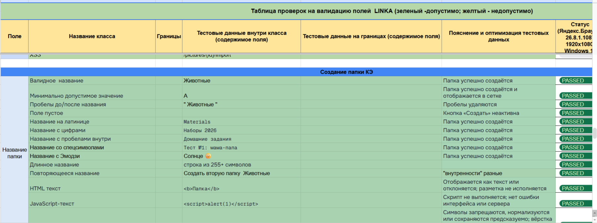

Коммерческий  Проект Linka 

 Веб-редактор учебных материалов для дефектологов. Сервис помогает создавать наборы заданий для занятий и адаптировать материалы под конкретного ребёнка.

Период тестирования: 2 октября — 20 ноября 2026  
Среда: тестовый стенд  
Методология: Kanban

## Задачи

- Проанализировать требования и определить объекты тестирования.
- Проверить пользовательские сценарии, роли и доступ к библиотеке наборов и картотеке учеников.
- Проверить API авторизации: вход, обновление токена и выход.
- Проверить работу интерфейса в Google Chrome и Яндекс.Браузере.

## Выполнено

- Составлены чек-листы и тест-кейсы в Google Таблицах; применены классы эквивалентности, граничные значения и попарное тестирование.
- Участвовала во взаимной проверке тестовой документации.
- Проведено функциональное, исследовательское и ролевое тестирование.
- API проверялось с помощью Swagger и Postman, сетевые запросы анализировались в DevTools. Создавала коллекции запросов и настраивала переменные, окружения в Postman для проверки API.
- Писала SQL-запросы к базе данных PostgreSQL в DBeaver для проверки данных.
- Дефекты регистрировались на Kanban-доске; отслеживался их жизненный цикл и выполнялся ретест после исправлений.
- Обсуждались вопросы по требованиям и тестированию с Team Lead на рабочих созвонах.

## Команда

12 тестировщиков, 7 разработчиков, Project Manager и  Team Lead.

## Результат

Продукт представлен заказчику и одобрен им.

Фрагмент тест-дизайна: класс эквивалентности

Фрагмент тест-кейса API

